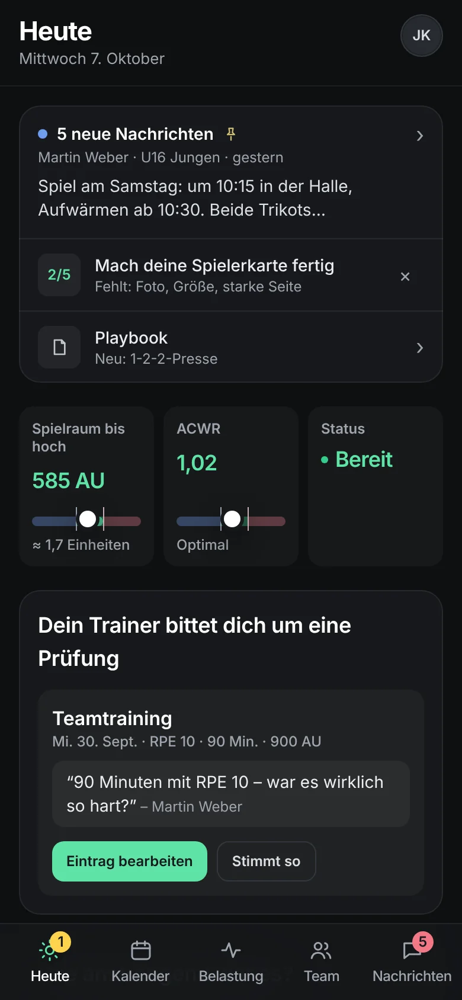
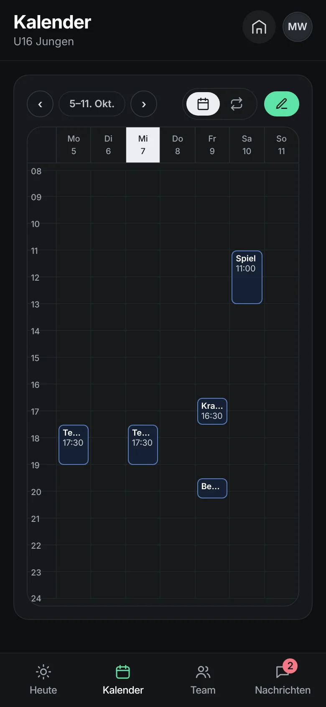
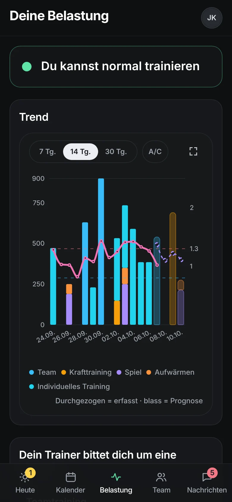

# Club OS

**The club app for teams, coaches and players.** Training and game planning,
"who is coming?", messages, halls, carpools and player load, in one calm app
for the phone and the desktop.

Live: **[clubos.hebinova.de](https://clubos.hebinova.de)** · in pilot with a
real club · English, German, French and Spanish

> **Kurz auf Deutsch.** Club OS ist eine Vereins-App für Trainer, Spieler und
> Vereinsverwaltung: Einheiten und Spiele planen, Zu- und Absagen mit einem
> Tipp, Nachrichten und Umfragen, Hallen, Fahrgemeinschaften und die
> Trainingsbelastung der Spieler (ACWR). Sie läuft als Web-App und lässt sich
> wie eine native App auf dem Handy installieren. Ein Beispielverein zeigt alles
> ohne Konto; echte Vereine arbeiten auf einem eigenen Server mit Anmeldung.

<p align="center">
  
  
  
</p>

## What it does

| For | What they get |
|---|---|
| **Players** | Their sessions and games, answering with one tap (or automatically "in"), saying they are away for a while, rating how hard a session was, their own training load and plans, team messages and polls, carpools to away games, the team's playbook, a player card with photo, number and position |
| **Coaches** | Today at a glance (who is coming, who is late, who did not answer), a smart calendar to plan sessions and weekly series by drag and drop, squads for games, attendance, every player's load traffic light (who is under- or overloaded), messages to the team or groups, playbooks, staff roles with fine-grained rights |
| **Club and department leads** | Departments, teams and halls, inviting coaches, club-wide news, which features each team uses, hall plans without double bookings |

Around it: push notifications in the reader's language, a calendar link and an
Apple Calendar sync, an installable app (PWA) that stays signed in, consent and
parental consent for health data, data export and account deletion, a problem
report button.

## Try it

- **Demo club:** open [clubos.hebinova.de](https://clubos.hebinova.de) and
  choose *Try the demo* (as coach, player or club). No account; everything you
  change stays in your browser.
- **Real club:** a club is founded with a founding code from us; players join
  with their team's link or QR code, coaches with a personal invitation.

## How it is built

```txt
           one interface (src/features, src/app)
                          │
             one data layer (src/shared/data)
                 ┌────────┴────────┐
        demo club (local)     club server (Supabase)
        in the browser,       Postgres with row-level security,
        seeded, no account    Auth, Storage, Edge Functions, pg_cron
```

- **One app, two stores.** The demo club and real clubs use the same screens and
  the same data layer; only the store behind it differs. Nothing is built twice.
- **The database is the guard.** Every right a coach or player has is enforced
  by row-level security and database functions (`supabase/pilot/`), with tests
  that act as each role. The app's own checks only shape the interface.
- **Privacy by design.** EU region, health data only with consent (parents for
  under-16s), coaches see players only through a team they share, rate limits on
  everything that can be called before signing in, no plain IP addresses stored.

| Part | Technology |
|---|---|
| App | Next.js 15 (App Router), React 19, TypeScript, Tailwind CSS |
| Server | Supabase: Postgres 17, row-level security, Auth, Storage, Edge Functions (Deno), pg_cron |
| Hosting | Vercel (app), Supabase EU (Paris) |
| Quality | GitHub Actions on every pull request: typecheck, all texts in four languages, build, a browser smoke test of every page, the landing checks, unit tests and the database access tests on Postgres |

### Repository map

```txt
src/app/               routes (Next.js App Router): /coach, /athlete, /club, /join, /found, /login, …
src/features/          one folder per product area (calendar, load, messages, onboarding, people, …)
src/shared/data/       the data layer: schema, repository (the only place that touches storage),
                       seed of the demo club, server store and its table mappings
src/shared/i18n/       translations (en, de, fr, es) and formatting
supabase/pilot/        the club server: migrations 0001–0055, access tests, README
supabase/functions/    Edge Functions: push, calendar feed, Apple Calendar, login handoff
scripts/               smoke test, landing checks, screenshot and text tools
docs/                  decisions, plans and the run log (start at docs/README.md)
```

## Run it locally

```bash
npm install
npm run dev          # http://localhost:3000, the demo club works without any setup
```

To use a club server as well, copy `.env.example` to `.env.local` and fill in
`NEXT_PUBLIC_SUPABASE_URL` and `NEXT_PUBLIC_SUPABASE_PUBLISHABLE_KEY` (both are
public by design). `GEOAPIFY_API_KEY` (server only) is optional and turns on
address suggestions for halls.

### Checks

```bash
npm run typecheck
npm run check:i18n && npm run test:i18n      # every text in all four languages
npm run build
npm run start -- -p 3100 &                   # then:
npm run test:smoke                           # every page as player, coach and club; SMOKE_FULL=1 for all languages
npm run test:landing                         # landing page and entry routes
```

Unit tests: `test:load`, `test:series`, `test:calendar`, `test:store`,
`test:features`, `test:carpools`, `test:consent`, `test:address`, `test:build`.
The database tests run all migrations on a local Postgres and act as every role:
see [`supabase/pilot/README.md`](supabase/pilot/README.md).

## Documentation

- [`docs/README.md`](docs/README.md): where to find what
- [`DESIGN.md`](DESIGN.md): how Club OS looks and feels
- [`AGENTS.md`](AGENTS.md) and [`CLAUDE.md`](CLAUDE.md): rules for building and reviewing (also for AI agents)
- [`docs/simplify-progress.md`](docs/simplify-progress.md): every change, why, and how it was checked

## Status

In pilot since autumn 2026. Open work and ideas: [`docs/plan-next-runs.md`](docs/plan-next-runs.md).
Questions or a pilot for your club: ben.hebling@gmx.de.

© 2026 Club OS. All rights reserved.
